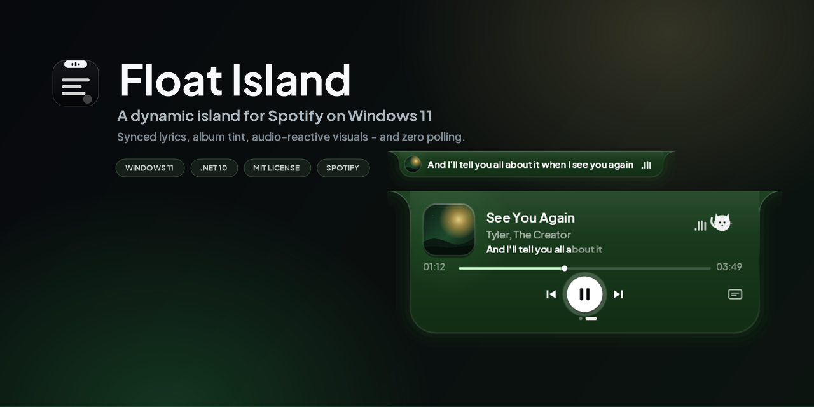
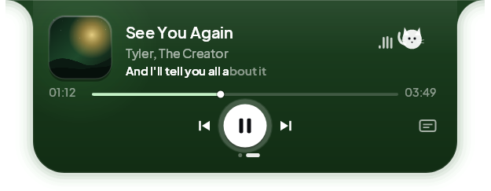
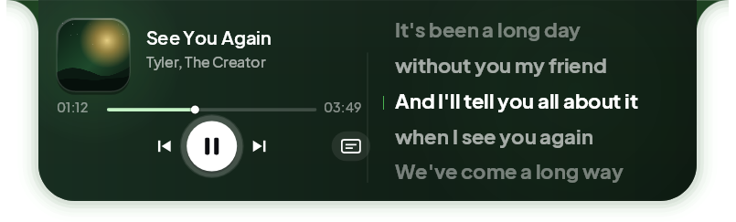
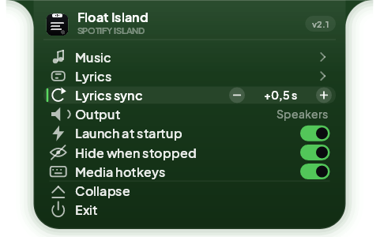
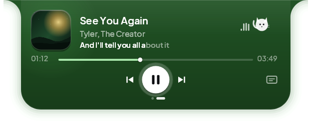

<div align="center">
  <a href="https://github.com/morganaji17-gif/FloatIsland">
    
  </a>

  <p>
    <a href="https://github.com/morganaji17-gif/FloatIsland/actions/workflows/build.yml"></a>
    
    
    
    
  </p>

  <p><b>A dynamic-island style overlay for Spotify on Windows 11.</b><br>
  Synced lyrics, album-tinted glass, audio-reactive details - and nothing rendered while paused.</p>
</div>

<p align="center">
  
</p>

Float Island hangs from the top centre of the screen and stays out of the way. It reads
Spotify's media session through Windows SMTC, fetches synced lyrics from LRCLIB (or your
own `.lrc` files), and paints a compact player that morphs between a one-line pill, a
full player, a karaoke lyrics page and a quick-settings menu.

## Highlights

- **Attached, not floating in the middle** - a flat top edge, flared shoulders, rounded
  lower corners, flush against the display. No title bar, no frame, no taskbar entry,
  and it never steals focus.
- **Spotify only** - Chrome, VLC, YouTube and everything else are ignored.
- **Synced lyrics** - LRCLIB (free, no API key) and/or a local folder of `.lrc` files,
  with a karaoke-style reveal of the current line.
- **Album tint** - the body follows the dominant colour of the cover art, with a soft
  coloured halo, a tinted progress bar and a matching menu accent.
- **Real audio-reactive input** - Windows **process loopback capture** isolates Spotify's
  rendered audio (not the microphone, not other apps) and drives the equaliser bars.
- **A menu that feels native** - icon rows, inline on/off switches, the current output
  device, a lyric-timing stepper, and a version chip.
- **Global hotkeys** - `Ctrl+Alt+Space` / `Left` / `Right` for play-pause and track skip,
  with a quick visual peep so a keypress always has feedback.
- **Out of the way** - hides itself while a fullscreen app is focused, and the overlay is
  click-through outside the island body.
- **Event-driven** - no metadata polling, and no frame is blitted while paused.

## A closer look

| Collapsed | Player | Lyrics |
|:---:|:---:|:---:|
|  |  |  |

| Menu | Volume | Album tint |
|:---:|:---:|:---:|
|  |  |  |

### Design notes

The interface is drawn with Skia at 60 fps and animated with a spring (stiffness 240,
damping 25). The window itself never resizes: the body morphs inside a fixed surface, so
every transition - pill to player, player to lyrics, menu open - is one continuous shape.

- **Type**: Plus Jakarta Sans (SemiBold / Medium / Bold), bundled under the SIL OFL.
- **Surface**: a near-black vertical gradient, a hairline top highlight, a soft bottom
  edge, and an album-coloured glow that is contrast-clamped so white text always reads.
- **Artwork**: rounded cover with a drop shadow, an inner top light and a tinted halo.
- **Controls**: a solid white play button, hover halos, a progress knob, and a
  bottom-edge playback line on the collapsed pill.
- **Lyrics**: the active line gets an album-tinted marker, the page reveals in a stagger,
  and the album wash fades in behind the text.
- **Menu**: grouped rows, real switches, a chevron for navigation and a `vX.Y` chip.

## Requirements

- **OS**: Windows 11 (process loopback needs build 20348+; degrades gracefully otherwise)
- **App**: Spotify Desktop for Windows
- **Runtime**: .NET 10 Desktop Runtime (x64) for the framework-dependent build

## Nothing appears? (troubleshooting)

Float Island is built to stay invisible until there is something to show, so "I ran it and
nothing happened" is usually one of these, in order:

1. **It is hidden until Spotify plays.** Launch it and you'll see a *"Waiting for
   Spotify…"* pill for ~4.5 s; after that it hides itself until playback starts. Open the
   **Spotify desktop** app and press play.
2. **Force it up:** left-click the tray icon, or **run the app a second time** — a second
   launch now asks the running island to show itself instead of silently exiting.
3. **Prove the renderer works, without Spotify:** `FloatIsland.exe --skia-demo` draws a
   sample player for a few seconds. If that appears, detection is the only question.
4. **Antivirus.** Unsigned builds are blocked by behaviour-based AV. On a machine with
   **Trend Micro** the exe can refuse to start (`Access is denied`, nothing shows) even
   though it ran yesterday. Add a folder exception (see [SECURITY.md](SECURITY.md)) or
   build from source.
5. **Check the log:** `%APPDATA%\FloatIsland\Logs\floatisland_YYYYMMDD.log`. It records
   every show/hide, the SMTC session it found, and whether audio capture started.

## Antivirus and SmartScreen

Float Island is unsigned, and it does a few things that look suspicious to a heuristic
engine (it overlays the desktop, captures **Spotify's own** audio to drive the
visualiser, and can add itself to autostart if you ask it to). Behaviour-based AV
products - Trend Micro, Kaspersky, Avast - and SmartScreen may therefore block or warn
about it. It is a **false positive**; see [SECURITY.md](SECURITY.md) for exactly what
the app does and does not do.

- Verify a download against the `SHA256SUMS.txt` on the release page:
  `Get-FileHash FloatIsland-win-x64.zip -Algorithm SHA256`
- Or build it yourself from source.
- Or whitelist the folder in your AV product.

The permanent fix is code signing; signed binaries carry reputation and stop being
flagged.

## Download

Grab a zip from the **[latest release](https://github.com/morganaji17-gif/FloatIsland/releases/latest)**:

| Asset | Size | Needs |
|---|---|---|
| `FloatIsland-win-x64.zip` | ~100 MB | nothing - **self-contained**, just unzip and run |
| `FloatIsland-win-x64-fdd.zip` | ~2 MB | the .NET 10 Desktop Runtime |

1. Unzip anywhere (e.g. `C:\Users\<you>\FloatIsland`).
2. Run `FloatIsland.exe --skia` - or `FloatIsland.exe` for the WPF renderer.
3. Optional, for Start Menu / Desktop shortcuts:
   ```powershell
   powershell -ExecutionPolicy Bypass -File .\Shortcuts.ps1
   ```

The release zip is **self-contained** (no .NET install required).

> **SmartScreen**: the builds are unsigned, so Windows may warn the first time.
> Choose *More info* -> *Run anyway*. If the file was blocked after unzipping, open the
> zip's **Properties -> Unblock** before extracting, or right-click the exe ->
> Properties -> Unblock.

No installer, no background service, no account. It only needs Spotify Desktop running.

## Run it

**From a release build**

```powershell
# unzip FloatIsland-win-x64.zip, then
.\FloatIsland.exe --skia     # Skia renderer (recommended: lightest, smoothest)
.\FloatIsland.exe            # WPF renderer
```

**From source**

```powershell
git clone https://github.com/morganaji17-gif/FloatIsland.git
cd FloatIsland
dotnet build -c Release -p:Platform=x64
.\bin\x64\Release\net10.0-windows10.0.19041.0\win-x64\FloatIsland.exe --skia
```

**Install as an app (Start Menu / Desktop shortcut)**

```powershell
powershell -ExecutionPolicy Bypass -File .\install.ps1
# options: -Startup  (also add a Startup shortcut)
#          -Dest "D:\Apps\FloatIsland"
```

## Interaction

| State | Surface | Size | How to reach it | What you get |
|-------|---------|------|-----------------|--------------|
| Collapsed | LINE | 136-452 x 36 | paused **or** playing | cover + one line: the current lyric, or `title - artist` when there is none; EQ bars and a bottom-edge progress line |
| Expanded | MUSIC | 432 x 176 | click the island | cover, title, artist, current lyric, seek, prev / play / next, lyric toggle, mascot |
| Expanded | LYRICS | 576 x 176 | click the lyric toggle | two columns: cover/title/seek/controls left, divider, scrolling lyrics right |
| Menu | MENU | 316 x 198-232 | right-click the island, or the tray icon | Music / Lyrics / Lyrics sync / Output: `<device>` / Launch at startup / Hide when stopped / Media hotkeys / Collapse / Exit |
| Volume | VOLUME | 236 x 44 | change the system volume | speaker icon, level bar, percentage; auto-dismisses after 1.6 s |

- The expanded panel collapses again ~1.5 s after the pointer leaves.
- The island is hidden while playback is not running, and fades out rather than
  disappearing instantly. It peeks for ~4.5 s on launch so you can see it exists.
- Only the island body is clickable: the rest of the overlay surface is click-through, so
  it never swallows clicks meant for the desktop underneath.
- The menu switches are the settings themselves - click a row to toggle it in place.
- Launching the app while it is already running asks the existing island to show.

## Lyrics

Providers live behind `ILyricsProvider` (`Services/LyricsService.cs`):

- **`LrclibProvider`** - `https://lrclib.net` search, duration/artist-aware best match,
  `instrumental` flag honouring, LRC parsing (multi-timestamp lines, cs/ms/tenths).
- **`LocalLrcProvider`** - scans a folder for `.lrc` (synced) and `.txt` (plain) files,
  matching `Artist`/`Title` in the filename.

Fallbacks are explicit and never fake: *Loading lyrics...*, *Instrumental track*,
*No lyrics found for this track*, *Lyrics (not synchronized)*.

### Nudging the timing

Community LRC timings are often a few hundred ms out. The menu row **Lyrics sync** adjusts
a global nudge: click **-** to show lines earlier, **+** to show them later, or the middle
of the row to reset. The value is saved to `lyricsOffsetMs` and applied to both the karaoke
sweep and the scrolling page. Steps are 0.5 s, clamped to ±10 s.

## Hotkeys

Three global hotkeys are registered while the Skia renderer runs (toggle with the
**Media hotkeys** menu row, or `mediaHotkeys` in settings):

| Keys | Action |
|---|---|
| `Ctrl+Alt+Space` | play / pause |
| `Ctrl+Alt+Left` | previous track |
| `Ctrl+Alt+Right` | next track |

They drive Spotify through the same SMTC transport the buttons use, and flash the pill for
2.5 s so a keypress always gives feedback, even while paused. They are plain
`RegisterHotKey` combos, not the hardware media keys - those stay with Spotify itself.

## Fullscreen

While a fullscreen app is in the foreground (a game, a fullscreen video), the island hides
itself and comes back when you leave. Toggle with `hideWhenFullscreen` in settings. It
compares the foreground window against the whole monitor rect, so a merely maximised
window (taskbar still visible) does not count.

## Two renderers

| | WPF (`Controls/`, `MainWindow.xaml`) | Skia (`Overlay/`) - `--skia` |
|---|---|---|
| Window | WPF `AllowsTransparency` | Win32 layered + `UpdateLayeredWindow` |
| Drawing | XAML visual tree | SkiaSharp raster |
| Compositing | software (WPF limitation) | bitmap push per frame |
| Tray icon | yes | yes |
| Settings | WPF dialog | island menu (quick settings) |
| Status | **legacy** - kept for the settings dialog | **recommended** |

A WPF window with `AllowsTransparency` is composited in software, so its cost scales
with window area. The `--skia` path draws to a bitmap and hands it to the OS, which is
lighter and smoother. It is the default the shortcuts use; the WPF renderer is kept
only for the full settings dialog and will be dropped in a future major.

## Architecture

```
FloatIsland/
  MainWindow.xaml / .cs        WPF notch window, state machine, animations
  MainWindow.IslandSkin.cs     album wash, karaoke sweep, marquee (WPF helpers)
  Controls/IslandShape.cs      flared capsule geometry
  Controls/Visualizer.cs       WPF bar renderer + animatable corner radius
  Overlay/
    OverlayWindow.cs           Win32 layered window (UpdateLayeredWindow)
    IslandRenderer.cs          Skia renderer for every surface
    SkiaMode.cs                island state machine, input, SMTC, lyrics, audio
  Models/                      TrackInfo, AudioLevels, AppSettings
  Services/
    SMTCManager.cs             Spotify-only SMTC detection & transport
    ProcessLoopbackCapture.cs  per-process WASAPI loopback + FFT
    LyricsService.cs           provider abstraction + LRCLIB + local LRC
    AudioOutput.cs             Core Audio volume + output-device switching
    ArtworkCache.cs            LRU thumbnail cache
    SettingsManager.cs / StartupManager.cs / TrayIconService.cs / Log.cs
    SelfTest.cs                --selftest assertions
    IconMaker.cs               --make-icon (draws Assets/app.ico with Skia)
  Converters/                  WPF value converters
  Assets/Fonts/                Plus Jakarta Sans (SIL OFL 1.1)
  Assets/app.ico               application icon (generated by --make-icon)
  packaging/                   Scoop + winget manifests
  tools/make-demo.ps1          builds docs/demo.png from the render samples
  tools/make-banner.ps1        builds docs/banner.png for the README
  docs/                        screenshots and banner used by this README
  install.ps1                  publish + create shortcuts (from source)
  Shortcuts.ps1                create shortcuts next to a release build
  app.manifest                 per-monitor-v2 DPI, Windows 11
```

### Island state (Skia path)

`SkiaMode` owns a small state machine over the surfaces above. Geometry is animated
with a spring (stiffness 240, damping 25) at ~60 Hz; the window is a fixed size and
the body morphs inside it, so nothing resizes per frame. Input is hit-tested against
the rectangles the renderer reports while drawing, and the window follows the monitor
the pointer is on.

## Settings

`%APPDATA%\FloatIsland\settings.json`

| Setting | Default | Notes |
|---|---|---|
| `launchOnStartup` | false | HKCU `...\Run` |
| `startMinimized` | false | |
| `showWhenMusicStarts` | true | |
| `hideWhenMusicStops` | true | |
| `collapseWhenIdle` | true | |
| `enableAnimations` | true | |
| `verticalOffset` | 0 | px from the top edge (0 = flush) |
| `horizontalAlign` | Center | Left / Center / Right |
| `visualizerEnabled` | true | |
| `lyricsSource` | Auto | Auto / Lrclib / Local / None |
| `lyricsFolder` | - | folder scanned for local lyrics |
| `lyricsOffsetMs` | 0 | lyric timing nudge in ms (+ = later) |
| `mediaHotkeys` | true | Ctrl+Alt+Space / Left / Right |
| `hideWhenFullscreen` | true | hide while a fullscreen app is focused |

## Diagnostics

The executable has inert diagnostic modes (nothing runs unless invoked):

```powershell
FloatIsland.exe --selftest                    # pure-logic assertions; exits non-zero on failure
FloatIsland.exe --skia-shot                   # render every surface to PNG in .\shots\ and log its geometry
FloatIsland.exe --skia-bench [frames]         # per-frame render cost for collapsed / player / lyrics
FloatIsland.exe --skia-demo [seconds]         # show a live sample player (no Spotify needed)
FloatIsland.exe --smtc-probe [seconds]        # list SMTC sessions + Spotify metadata
FloatIsland.exe --smtc-cmd play|pause|next|prev|seek
FloatIsland.exe --selftest-capture spotify|<pid> [s]
FloatIsland.exe --art-probe [rounds] [gapSeconds]
FloatIsland.exe --lyrics-probe [local]
FloatIsland.exe --ui-probe [cycle] [stepSeconds]   # WPF renderer only: log window/notch geometry
```

`--selftest` and `--skia-shot` are what CI runs.

Other developer utilities:

```powershell
FloatIsland.exe --make-icon                     # redraw Assets/app.ico from the Skia artwork
powershell -File .\tools\make-demo.ps1          # compose docs/demo.png + tight crops
powershell -File .\tools\make-banner.ps1        # compose docs/banner.png
```

## Packaging

Manifests for package managers live in [`packaging/`](packaging) (Scoop + winget
templates - fill in the zip SHA256). For a manual release, tag `vX.Y.Z` and the release
workflow attaches the zips.

## Performance

Measured on a Ryzen 7 7435HS (16 threads), .NET 10 Release x64, 125 % scaling.

**Skia renderer (`--skia`)**

| State | CPU | Notes |
|---|---|---|
| Hidden (paused / stopped) | **~0 %** of one core | the render timer drops to a 5 Hz poll and no frame is blitted |
| Visible, playing | **~5 % of one core** (≈0.3 % of the whole CPU) | 60 fps, mascot + karaoke sweep + EQ animating |
| Per frame, measured | 0.35 ms collapsed, 0.83 ms player, 0.87 ms lyrics | `--skia-bench` |

Working set ~77-110 MB, private ~20-40 MB, 15-30 threads. The surface is a single
900x300 bitmap pushed with `UpdateLayeredWindow` (≈1.1 MB per frame at 60 fps).

The renderer caches its paints, gradient shaders and glows; creating them per frame cost
about 2x more. `--skia-bench [frames]` reports the numbers above on your machine.

**WPF renderer** (the legacy path)

| Scenario | CPU | Working set |
|---|---|---|
| Idle - paused | ~0.4 % of one core | ~160 MB |
| Playing - lyrics + capture | ~4-5 % of one core | ~170 MB |
| Loopback capture + FFT alone (48 kHz) | 2.6-4.1 % of one core | - |

Disk: the framework-dependent zip is ~2 MB, the self-contained one ~100 MB (the .NET
runtime dominates).

## Known limitations

1. Process loopback requires Windows 10 build 20348+; if it is unavailable the reason
   is logged and the visualizer stays static - capture is never silently widened to
   system-wide loopback.
2. Spotify Free sometimes omits album art from SMTC.
3. Spotify must permit third-party SMTC access (Spotify -> Settings -> Connected Apps).
4. Spotify Web Player is not detected (by design).
5. LRCLIB coverage is community-maintained; instrumentals and obscure tracks may have
   no lyrics.
6. The Skia path exposes quick settings (startup, hide-when-stopped, output device) in
   its menu; the full settings dialog is still the WPF one.

## Disclaimer

Not affiliated with, endorsed by, or connected to Apple, Spotify or any phone maker.
"Dynamic Island" is a trademark of Apple and is used here descriptively. Spotify is a
trademark of Spotify AB. The app talks to Spotify only through the Windows media
transport controls that Spotify itself exposes, and to LRCLIB for lyrics.

## License

MIT - see [LICENSE](LICENSE). Third-party components are listed in
[THIRD_PARTY_NOTICES.md](THIRD_PARTY_NOTICES.md).
