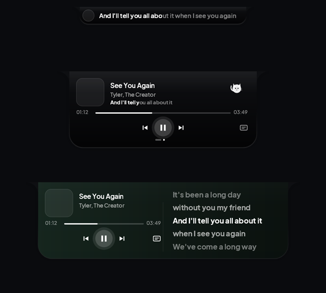

# Sono Island

A dynamic-island style **top-edge overlay for Spotify on Windows 11**. It hangs from
the top centre of the screen, shows the current lyric, and can render either as a WPF
window or as a raw Win32 layered window drawn with Skia.

Spotify only. No other player's audio or metadata is picked up.



Collapsed pill, player, lyrics. More in [`docs/`](docs).

## Highlights

- **Attached island** - a flat top edge that overhangs the body by a flare radius on
  each side, rounded lower corners, flush against the top edge, centred on the display.
  No title bar, no frame, no taskbar entry, never steals focus.
- **Spotify-only** - everything else (Chrome, VLC, YouTube, ...) is ignored.
- **Synced lyrics** - LRCLIB (free, no API key) and/or your own `.lrc` files, with a
  karaoke-style reveal of the current line.
- **Album tint** - the island background follows the dominant colour of the cover art.
- **Real audio-reactive input** - Windows **process loopback capture** isolates
  Spotify's rendered audio (not the microphone, not other apps).
- **Media output switcher** - a volume surface driven by Core Audio, plus a menu entry
  that cycles the default playback device.
- **Tray icon** - left/right click for Show island / Exit. The island menu also holds the
  quick settings (launch at startup, hide when stopped, output device).
- **Event-driven** - no polling for metadata; nothing renders while paused.

## Requirements

- **OS**: Windows 11 (process loopback needs build 20348+; degrades gracefully otherwise)
- **App**: Spotify Desktop for Windows
- **Runtime**: .NET 10 Desktop Runtime (x64) for the framework-dependent builds

## Download

Grab a zip from the **[latest release](https://github.com/USER/SonoIsland/releases/latest)**:

| Asset | Size | Needs |
|---|---|---|
| `SonoIsland-win-x64.zip` | ~100 MB | nothing - **self-contained**, just unzip and run |
| `SonoIsland-win-x64-fdd.zip` | ~2 MB | the .NET 10 Desktop Runtime |

1. Unzip anywhere (e.g. `C:\Users\<you>\SonoIsland`).
2. Run `SonoIsland.exe --skia` - or `SonoIsland.exe` for the WPF renderer.
3. Optional, for Start Menu / Desktop shortcuts:
   ```powershell
   powershell -ExecutionPolicy Bypass -File .\Shortcuts.ps1
   ```

The release zip is **self-contained** (no .NET install required).

> **SmartScreen**: the builds are unsigned, so Windows may warn the first time.
> Choose *More info* -> *Run anyway*. If the file was blocked after unzipping, open the
> zip's **Properties -> Unblock** before extracting, or right-click the exe ->
> Properties -> Unblock.

No installer, no background service, no account. It only needs Spotify Desktop running.

## Run it

**From a release build**

```powershell
# unzip SonoIsland-win-x64.zip, then
.\SonoIsland.exe --skia     # Skia renderer (recommended: lightest, smoothest)
.\SonoIsland.exe            # WPF renderer
```

**From source**

```powershell
git clone <repo>
cd SonoIsland
dotnet build -c Release -p:Platform=x64
.\bin\x64\Release\net10.0-windows10.0.19041.0\win-x64\SonoIsland.exe --skia
```

**Install as an app (Start Menu / Desktop shortcut)**

```powershell
powershell -ExecutionPolicy Bypass -File .\install.ps1
# options: -Startup  (also add a Startup shortcut)
#          -Dest "D:\Apps\SonoIsland"
```

## Interaction

| State | Surface | Size | How to reach it | What you get |
|-------|---------|------|-----------------|--------------|
| Collapsed | LINE | 124-440 x 36 | paused **or** playing | cover + one line: the current lyric, or `title - artist` when there is none |
| Expanded | MUSIC | 432 x 176 | click the island | cover, title, artist, current lyric, seek, prev / play / next, lyric toggle, mascot |
| Expanded | LYRICS | 576 x 176 | click the lyric toggle | two columns: cover/title/seek/controls left, divider, scrolling lyrics right |
| Menu | MENU | 316 x 152 | right-click the island, or the tray icon | Music / Lyrics / Output: <device> / Launch at startup: on-off / Hide when stopped: on-off / Collapse / Exit |
| Volume | VOLUME | 236 x 44 | change the system volume | speaker icon, level bar, percentage; auto-dismisses after 1.6 s |

- The expanded panel collapses again ~1.5 s after the pointer leaves.
- The island is hidden while playback is not running, and fades out rather than
  disappearing instantly.

## Lyrics

Providers live behind `ILyricsProvider` (`Services/LyricsService.cs`):

- **`LrclibProvider`** - `https://lrclib.net` search, duration/artist-aware best match,
  `instrumental` flag honouring, LRC parsing (multi-timestamp lines, cs/ms/tenths).
- **`LocalLrcProvider`** - scans a folder for `.lrc` (synced) and `.txt` (plain) files,
  matching `Artist`/`Title` in the filename.

Fallbacks are explicit and never fake: *Loading lyrics...*, *Instrumental track*,
*No lyrics found for this track*, *Lyrics (not synchronized)*.

## Two renderers

| | WPF (`Controls/`, `MainWindow.xaml`) | Skia (`Overlay/`) - `--skia` |
|---|---|---|
| Window | WPF `AllowsTransparency` | Win32 layered + `UpdateLayeredWindow` |
| Drawing | XAML visual tree | SkiaSharp raster |
| Compositing | software (WPF limitation) | bitmap push per frame |
| Tray icon | yes | yes |
| Settings | WPF dialog | island menu (quick settings) |
| Status | **legacy** - kept for the settings dialog | **recommended** |

A WPF window with `AllowsTransparency` is composited in software, so its cost scales
with window area. The `--skia` path draws to a bitmap and hands it to the OS, which is
lighter and smoother. It is the default the shortcuts use; the WPF renderer is kept
only for the full settings dialog and will be dropped in a future major.

## Architecture

```
SonoIsland/
  MainWindow.xaml / .cs        WPF notch window, state machine, animations
  MainWindow.IslandSkin.cs     album wash, karaoke sweep, marquee (WPF helpers)
  Controls/IslandShape.cs      flared capsule geometry
  Controls/Visualizer.cs       WPF bar renderer + animatable corner radius
  Overlay/
    OverlayWindow.cs           Win32 layered window (UpdateLayeredWindow)
    IslandRenderer.cs          Skia renderer for every surface
    SkiaMode.cs                island state machine, input, SMTC, lyrics, audio
  Models/                      TrackInfo, AudioLevels, AppSettings
  Services/
    SMTCManager.cs             Spotify-only SMTC detection & transport
    ProcessLoopbackCapture.cs  per-process WASAPI loopback + FFT
    LyricsService.cs           provider abstraction + LRCLIB + local LRC
    AudioOutput.cs             Core Audio volume + output-device switching
    ArtworkCache.cs            LRU thumbnail cache
    SettingsManager.cs / StartupManager.cs / TrayIconService.cs / Log.cs
    SelfTest.cs                --selftest assertions
    IconMaker.cs               --make-icon (draws Assets/app.ico with Skia)
  Converters/                  WPF value converters
  Assets/Fonts/                Plus Jakarta Sans (SIL OFL 1.1)
  Assets/app.ico               application icon (generated by --make-icon)
  packaging/                   Scoop + winget manifests
  tools/make-demo.ps1          builds docs/demo.png from the render samples
  docs/                        screenshots used by this README
  install.ps1                  publish + create shortcuts (from source)
  Shortcuts.ps1                create shortcuts next to a release build
  app.manifest                 per-monitor-v2 DPI, Windows 11
```

### Island state (Skia path)

`SkiaMode` owns a small state machine over the surfaces above. Geometry is animated
with a spring (stiffness 240, damping 25) at ~120 Hz; the window is a fixed size and
the body morphs inside it, so nothing resizes per frame. Input is hit-tested against
the rectangles the renderer reports while drawing, and the window follows the monitor
the pointer is on.

## Settings

`%APPDATA%\SonoIsland\settings.json`

| Setting | Default | Notes |
|---|---|---|
| `launchOnStartup` | false | HKCU `...\Run` |
| `startMinimized` | false | |
| `showWhenMusicStarts` | true | |
| `hideWhenMusicStops` | true | |
| `collapseWhenIdle` | true | |
| `enableAnimations` | true | |
| `verticalOffset` | 0 | px from the top edge (0 = flush) |
| `horizontalAlign` | Center | Left / Center / Right |
| `visualizerEnabled` | true | |
| `lyricsSource` | Auto | Auto / Lrclib / Local / None |
| `lyricsFolder` | - | folder scanned for local lyrics |

## Diagnostics

The executable has inert diagnostic modes (nothing runs unless invoked):

```powershell
SonoIsland.exe --selftest                    # pure-logic assertions; exits non-zero on failure
SonoIsland.exe --skia-shot                   # render every surface to PNG in .\shots\ and log its geometry
SonoIsland.exe --smtc-probe [seconds]        # list SMTC sessions + Spotify metadata
SonoIsland.exe --smtc-cmd play|pause|next|prev|seek
SonoIsland.exe --selftest-capture spotify|<pid> [s]
SonoIsland.exe --art-probe [rounds] [gapSeconds]
SonoIsland.exe --lyrics-probe [local]
SonoIsland.exe --ui-probe [cycle] [stepSeconds]   # WPF renderer only: log window/notch geometry
```

`--selftest` and `--skia-shot` are what CI runs.

Other developer utilities:

```powershell
SonoIsland.exe --make-icon      # redraw Assets/app.ico from the Skia artwork
powershell -File .\tools\make-demo.ps1   # compose docs/demo.png from the render samples
```

## Packaging

Manifests for package managers live in [`packaging/`](packaging) (Scoop + winget
templates - fill in the repo URL and the zip SHA256). For a manual release, tag
`vX.Y.Z` and the release workflow attaches the zips.

## Performance

Measured on the WPF renderer (Lenovo LOQ: Ryzen 7 7435HS, 12 GB RAM, 1536x864 @ 125%,
.NET 10, Release x64):

| Scenario | CPU | Working set |
|---|---|---|
| Idle - paused | ~0.4 % of one core | ~160 MB |
| Playing - lyrics + capture | ~4-5 % of one core | ~170 MB |
| Loopback capture + FFT alone (48 kHz) | 2.6-4.1 % of one core | - |

The Skia path composites a bitmap instead of a WPF visual tree, so it is lighter; the
window is also sized to the surface, not a fixed 660x260 overlay.

## Known limitations

1. Process loopback requires Windows 10 build 20348+; if it is unavailable the reason
   is logged and the visualizer stays static - capture is never silently widened to
   system-wide loopback.
2. Spotify Free sometimes omits album art from SMTC.
3. Spotify must permit third-party SMTC access (Spotify -> Settings -> Connected Apps).
4. Spotify Web Player is not detected (by design).
5. LRCLIB coverage is community-maintained; instrumentals and obscure tracks may have
   no lyrics.
6. The Skia path exposes quick settings (startup, hide-when-stopped, output device) in
   its menu; the full settings dialog is still the WPF one.

## Disclaimer

Not affiliated with, endorsed by, or connected to Apple, Spotify or any phone maker.
"Dynamic Island" is a trademark of Apple and is used here descriptively. Spotify is a
trademark of Spotify AB. The app talks to Spotify only through the Windows media
transport controls that Spotify itself exposes, and to LRCLIB for lyrics.

## License

MIT - see [LICENSE](LICENSE). Third-party components are listed in
[THIRD_PARTY_NOTICES.md](THIRD_PARTY_NOTICES.md).
